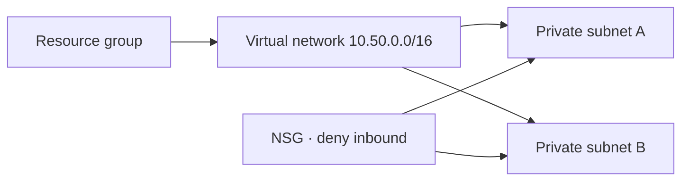

# Azure Secure Platform Baseline

A portfolio lab for a small Azure network foundation managed with Terraform. The baseline composes a reusable network module for an isolated virtual network, private subnets, and an inbound-deny network security group.

## What this demonstrates

- A reusable Terraform module with typed inputs and outputs
- Resource group and virtual network lifecycle
- Subnet map inputs for repeatable environment layouts
- Explicit inbound deny rule and subnet-to-NSG association
- Plan-first cloud operations and credential-free CI validation

## Architecture



## Repository layout

- `versions.tf`, `providers.tf`: Terraform and Azure provider constraints
- `variables.tf`: region, naming, CIDRs, environment, and subnet inputs
- `modules/network`: reusable resource group, VNet, subnets, and NSG
- `network.tf`, `outputs.tf`: root module composition and public outputs
- `.github/workflows/terraform.yml`: format and validate on pull requests

## Prerequisites

- Terraform 1.7+
- Azure CLI and an authenticated subscription for planning against a real account
- Set `ARM_SUBSCRIPTION_ID` in your local shell; use a managed identity or workload identity in automation

## Try it safely

```sh
cp terraform.tfvars.example terraform.tfvars
terraform init
terraform fmt -check -recursive
terraform validate
terraform plan
```

The repository never runs `terraform apply`. A plan may query Azure and requires credentials; review the account and proposed changes before any apply. The baseline creates network resources only if applied. No VMs, AKS, public IPs, or paid gateways are included.

## Security notes

- The NSG denies inbound traffic; add narrowly scoped rules only with an explicit use case.
- No public IPs or internet-facing workloads are defined.
- Local state is for learning only. Production state belongs in an encrypted, access-controlled remote backend.
- Never commit `terraform.tfvars`, state, credentials, or private keys. `.terraform.lock.hcl` is intentionally not ignored and should be committed after initialization.

## Next steps

Add a separately reviewed AKS layer, managed identity, private endpoints, and environment-specific policy examples. Document costs and cleanup before enabling paid resources.

## License

MIT. See [LICENSE](LICENSE).
